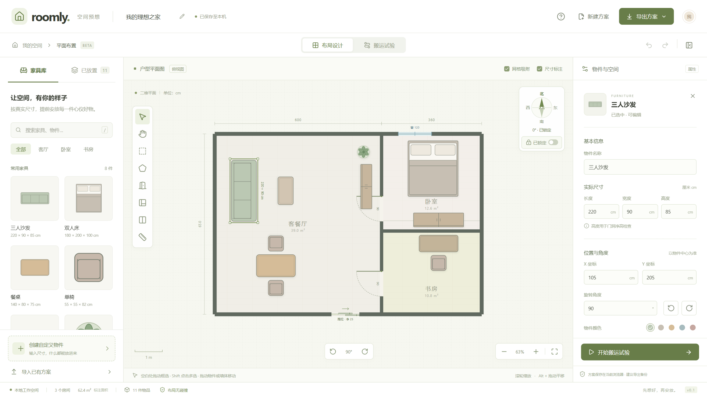

# Roomly · 空间预想

一个按真实尺寸设计二维户型、摆放家具并试验搬运路线的网站。全部计算和方案保存都在浏览器内完成，无需登录或配置后端。

[网站入口](https://hellolihua.github.io/House_Manage/)（首次部署成功后可用） · [问题反馈](https://github.com/HelloLiHua/House_Manage/issues) · [MIT 许可](LICENSE)



**核心体验：画户型 → 输入家具尺寸 → 摆放与旋转 → 试搬并检查碰撞。**

Roomly is a browser-based 2D floor planner with dimensioned furniture, sliding doors, and interactive furniture-moving collision checks. The current interface is in Simplified Chinese. Plans stay in your browser and can be exported as JSON or SVG.

## 启动

环境：Node.js 22.12+（或 24 LTS）与 npm。

```sh
npm ci
npm run dev -- --host 127.0.0.1 --port 5173
```

打开 http://127.0.0.1:5173 。开发预览期间保持终端运行。

```sh
npm run build     # 检查类型并生成 dist 静态网站
npm run preview   # 预览构建结果
npm run lint      # 静态检查
npm test          # 几何、门洞和方案验证测试
npm run test:e2e  # 浏览器交互测试
```

浏览器测试使用独立测试环境，不接触日常浏览器数据。Windows 本地使用 Edge；其他平台和 CI 使用 Chromium，首次运行请执行 `npx playwright install chromium`。

## 已实现

- 内置三房间示例，也可以新建空白方案。
- 按厘米绘制矩形房间、墙体和斜墙，设置墙厚；共线相邻墙体自动合并。选择模式下可拖动整段墙体，门随墙移动。
- 在墙体上添加窗户，设置宽高、窗台高度和沿墙位置；支持沿墙拖动、随墙移动、撤销和导出。
- 在墙体上添加门洞，并设置净宽、净高、沿墙位置和开启方向。
- 添加推拉门，或将已有平开门切换为推拉门；支持双扇错叠、单扇沿墙、滑动方向、轨道所在墙侧、开启程度及门扇厚度。
- 推拉门显示门洞总宽和当前可通行净宽，搬运检测包含未打开区域和滑到一旁的门扇。
- 沙发、床、餐桌、单椅、柜子、绿植等家具模板；自定义矩形物件。
- 编辑物件名称、长宽高、中心坐标、旋转角度和颜色。
- 鼠标框选和 Shift 点选多件家具，整组移动、复制、删除与方向键微调。
- 拖动、旋转、网格吸附、测距、缩放、平移、复制、删除、撤销和重做。
- 东南西北指示盘，支持自由旋转与锁定，可拖动或输入北向角度；朝向随方案保存，JSON 与 SVG 导出均保留。
- 布局设计允许自由摆放，并显示墙体、物件碰撞。
- 搬运试验检查连续拖动和旋转的中间姿态，碰撞时停在上一个可用位置。
- 记录已走过的中心路线与移动距离；可回到起点，结束后可撤销整段试验。
- 自动保存到当前浏览器；支持导出/导入 JSON 完整方案及导出 SVG 平面图。

## 典型用法

1. 新建空白方案，选择“绘制房间”，拖出房间区域；或用墙体工具绘制不规则边界。
2. 点击墙体修改长度或厚度；使用门洞工具在墙上开口，并填写实际净尺寸。
3. 添加家具或自定义物件，填写长宽高，再拖到需要的起始位置。
4. 选中物件，设定预留间隙，点击“开始搬运试验”。
5. 拖动物件，按 Q / E 旋转；观察拐角、门洞和其他家具是否阻碍通过。
6. 导出 JSON 保存可编辑方案，导出 SVG 用于分享或继续矢量排版。

### 多选物件

切换到选择工具（V），在画布空白处或房间地面按住鼠标拖出选择框，框碰到的物件会高亮，松手完成选择；可以从任意方向拖动。按住 Shift 点击物件可追加或取消选择，Shift + 框选可继续追加。左侧“已放置”列表也支持 Shift 点选。

选中多件后，拖动其中任意一件会一起平移，并保持原有间距与角度。右侧显示所选物件，可整组复制、删除；方向键微调 1 cm，Shift + 方向键微调 10 cm。网格吸附按整组移动量对齐，避免改变物品间距。复制后保留相对位置，需要自行调整可能的重叠。

框选和点击只改变选择，不增加撤销记录。一次整组移动、复制或删除都可一步撤销；拖动中按 Esc、窗口失焦或触摸中断会取消本次操作。松手后的位置自动保存，JSON 导出包含全部物件；SVG 不包含框选边框。搬运试验仍逐件进行，单独选择一件后开始试搬。

### 拖动墙体

在布局设计中切换到选择工具（V），按住墙体拖动即可整体平移，水平墙、竖墙和斜墙均可移动。墙体长度、角度、厚度保持不变，墙上的门洞与推拉门跟随移动。开启网格吸附时移动量按 10 cm 对齐，关闭后按 1 cm 调整。

松手后保存，一次拖动可一步撤销；单击只选中墙体，不产生编辑记录。拖动时按 Esc、触摸中断或窗口失去焦点会取消本次移动。Alt + 拖动仍用于平移画布，搬运试验中不能移动墙体。墙体是独立几何，相邻墙和房间地面区域不会自动拉伸，可按需要调整其他墙体及区域标注。

### 窗户

点击画布工具栏“添加窗户”（N），再点击墙体；也可以先选中墙体，在右侧点击“在墙体上添加窗户”。新窗户默认宽 120 cm、高 150 cm、窗台高 90 cm，较短的墙会自动缩小默认宽度。蓝色双线表示窗框与玻璃，右侧可设置宽高、窗台高度和距墙起点的中心距离；窗台高度指地面到窗户底边的距离。

选择模式（V）下拖动窗户可沿所在墙体移动，网格吸附开启时按 10 cm 调整，关闭时按 1 cm 调整；水平墙、竖墙、斜墙均支持。窗户不能越过墙端、其他窗户或门洞，数值修改与导入也会检查重叠。拖动墙体时门窗一起移动，缩短墙体不能截掉已有门窗；删除墙体同时删除其门窗。合并墙体保留窗户实际位置；若合并会让门窗重叠，会提示并取消绘制。

单次拖动可一步撤销，Esc、失焦或触摸中断取消本次拖动；点击只选中。窗户支持删除、撤销、重做、自动保存以及 JSON/SVG 导出。旧版方案仍可导入；JSON 的可选 `windows` 数组保存窗户及所在墙体、宽高、窗台高度和沿墙位置。

窗户目前用于二维布局标注，没有模拟窗扇开合、窗台外凸或从窗户搬运。搬运检测始终保留窗户处的墙体阻挡，包括窗台高度为 0 的窗户；家具不能穿窗而过。

### 平开门的门轴和开启方向

选中画布上的平开门，在右侧分别设置“门轴位置”和“开启方向”。例如水平墙可以选择左侧或右侧门轴，再选择向上或向下开启，共四种组合。竖墙和斜墙的按钮文字会随墙体方向变化，与画布上的位置对应；门轴用绿色圆点标出。

方向随方案保存，支持撤销、重做以及 JSON / SVG 导出。旧方案沿用原来的门轴位置；新字段 `hingeSide` 表示沿墙体起点或终点的一端，`flip` 表示开启的墙侧。合并相邻墙体时会保持门轴和门扇的实际位置。平开门的门扇仍仅作图示，搬运检测检查门洞净宽与净高。

### 推拉门

选择画布左侧“添加推拉门”（S），点击墙体即可创建。已有门洞可直接选中，在右侧“门的类型”中切换为推拉门，原来的尺寸与位置保持不变。

- **双扇错叠**：两扇等宽门在两条轨道上重叠。全开时净宽为门洞总宽的一半，例如总宽 180 cm、全开净宽 90 cm；开启程度 50% 时净宽为 45 cm。
- **单扇沿墙**：一整扇门滑到墙旁，全开时整个开口可通行。需要为门扇停靠预留空间；侧面的门扇仍参与家具碰撞检测。
- “门扇滑向”按钮和图上的箭头对应；“切换轨道所在墙侧”控制门扇位于墙的哪一侧。
- 用滑块、百分比输入或“关闭／半开／全开”按钮调整开度。绿色虚线标出当前可通行开口，右侧实时显示净宽。
- 先在布局模式中设好门的状态，再进入搬运试验。检测使用当前静止状态，没有模拟推门动作、轨道五金及实际门框余量；可按实测可用尺寸保守填写。
- 原有 JSON 方案无需转换，未标注门类型的旧门按平开门处理。新参数随 JSON 保存、导入和撤销恢复，SVG 包含推拉门符号。

### 房屋朝向

画布右上角显示东、南、西、北，绿色箭头指向北方；手机窄屏下位于左下角。指示盘下方的开关默认关闭，显示“已锁定”。打开后显示“可调整”，可以用鼠标或手指拖动指示盘，让四个方向一起自由旋转；关闭开关即可固定当前朝向。

点击指示盘打开设置窗口，也可在窗口中解锁后选择北朝上、右、下、左，或输入 0–360° 之间的角度，支持小数与每次 15° 微调。角度从画面上方向顺时针计算：0° 北朝上，90° 北朝右，360° 等同于 0°。指示盘获得键盘焦点后，方向键可微调 1°，按住 Shift 微调 15°，Home 回到北朝上；锁定时这些调整均不可用。

画布中的拖动在松手时保存，整次拖动可一步撤销；按 Escape 或触摸中断会取消本次拖动。设置窗口先预览，点击“应用朝向”后一起保存角度和锁定状态；取消不会修改方案。支持撤销、重做，房屋与家具坐标保持不变，缩放和平移不会改变朝向。搬运试验中仍显示方位，结束试验后可修改。

朝向需根据实际户型图或现场测量手动设定，不会自动定位。旧方案默认上北下南、锁定朝向，已设置的北向会保留。JSON 的可选 `northAngle` 字段保存北向（0 ≤ 角度 < 360），`orientationLocked` 保存锁定状态（省略时按 `true` 处理）；SVG 平面图的顶部附带同一朝向的指示盘和角度说明。

尺寸均为厘米。物件坐标是中心位置，长度对应本地 X 轴、宽度对应本地 Y 轴。墙体按中心线绘制，厚度向两侧各延伸一半。房间面积按标注矩形计算，未扣除墙体。

## 快捷键

| 操作 | 快捷键 |
| --- | --- |
| 选择 / 平移 | V / H |
| 多选物件 | 空白处拖动框选，Shift 点击增减 |
| 追加框选 | Shift + 拖动 |
| 房间 / 墙体 / 门洞 / 测量 | B / W / D / M |
| 添加推拉门 | S |
| 添加窗户 | N |
| 绘制斜墙 | 绘墙时按住 Shift |
| 旋转 | Q / E，每次 15° |
| 微调位置 | 方向键 1 cm，Shift + 方向键 10 cm |
| 缩放 / 平移 | 滚轮 / Alt + 拖动 |
| 复制 / 删除 | Ctrl+D / Delete |
| 撤销 / 重做 | Ctrl+Z / Ctrl+Shift+Z |
| 导出可编辑方案 | Ctrl+S |
| 搜索家具 | / |

## 检测模型与边界

- 用分离轴检测判断旋转矩形和墙体/其他矩形是否相交。所有物件按长宽形成的外接矩形检测，圆形绿植也采用保守矩形。
- 运动按最大角点位移分段，步长不超过 1 cm，并增加 0.5 cm 的检测余量；快速拖动不能直接穿墙。预留间隙沿物件四边额外扩展。
- 门洞从墙体中切出真实开口；高度超出门洞净高的物件仍被阻挡。
- 推拉门使用与画面相同的门扇矩形检测，包括停靠到门洞外的单扇门。未打开的门洞部分按整段墙厚保守阻挡；双扇重叠式的最大通行宽度为总宽的一半。
- 检查的是保持直立的平面平移与旋转，只验证用户实际走过的路线。尚未自动搜索路线，也不证明不存在其他可行路径。
- 未模拟倾斜、抬起、拆卸、楼梯、楼层高度、平开门门扇、推门动作、人员占用和真实外形细节。
- 房间矩形是区域标注，墙体是独立几何。手动修改墙体端点后，相邻墙体和区域标注不自动跟随；可在墙体面板修改端点坐标对齐。
- 第一版没有 DWG/DXF 导入导出、云端同步、账号或多人协作。

## 文件格式与保存

JSON 是本应用的可编辑源文件（version: 1），保存房间、墙体、门洞、窗户和物件参数；SVG 是俯视图的矢量导出，不包含本应用的完整编辑语义。浏览器保存仅保留当前方案，清除站点数据会移除它；需要多个方案或长期备份时请导出 JSON。

主要模块：src/model.ts（数据与校验）、src/geometry.ts（碰撞和墙体）、src/Canvas.tsx（画布）、src/App.tsx（界面与操作）、src/usePlan.ts（编辑历史）。


## 部署到 GitHub Pages

首次手动上传，请按照 [GitHub 上传与网站发布说明](docs/GITHUB_UPLOAD.md) 操作。

仓库包含自动检查和部署流程 `.github/workflows/pages.yml`。在 GitHub 仓库的 **Settings → Pages → Build and deployment → Source** 中选择 **GitHub Actions**，向 `main` 推送代码后会自动执行代码检查、几何测试、浏览器测试、构建和部署。

项目站点使用 `https://<用户名>.github.io/<仓库名>/`。流程按仓库名自动设置静态资源基础路径，避免子目录部署后出现白屏。网站是纯静态应用，不需要服务器、数据库或 API 密钥。

网站的本地保存与浏览器及域名绑定；本地开发地址和公开网站不会共享已保存方案。可从原地址导出 JSON，再到公开网站导入。

## 参与和许可

发现问题可以提交 Issue；贡献代码请参阅 [CONTRIBUTING.md](CONTRIBUTING.md)。

采用 [MIT License](LICENSE)，允许使用、修改和再发布，需保留版权与许可声明。搬运试验是简化几何辅助工具，实际搬运需核对现场尺寸与条件。
